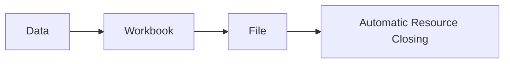

# AutoCloseable and Excel Reports

Creates an Excel report while using try-with-resources to close the workbook and output stream automatically.

## Responsibilities

1. **Report Data Provider (`ReportData`):** supplies people, column names, and the output path.
2. **Report Builder (`AutoCloseableApp`):** creates the sheet, styles the header, writes rows, and saves the workbook.
3. **Workbook (`XSSFWorkbook`):** holds the Excel sheets, cells, and styles.
4. **File Output (`FileOutputStream`):** writes the workbook to `docs/people-report.xlsx`.

## Learning Notes

- Try-with-resources closes resources in reverse declaration order, including when an exception occurs: the stream closes before the workbook.
- Build the report in this order: create the sheet, create the bold header style, write the header, write people, resize columns, and save.
- `sheet.autoSizeColumn(i)` resizes columns, despite the source comment referring to rows.
- `person.getMiddleName().orElse("")` writes an empty cell when no middle name is available.
- The path is relative to the working directory. This example expects the `docs` directory to exist.

## Concept Flow

## Implementation Flow

