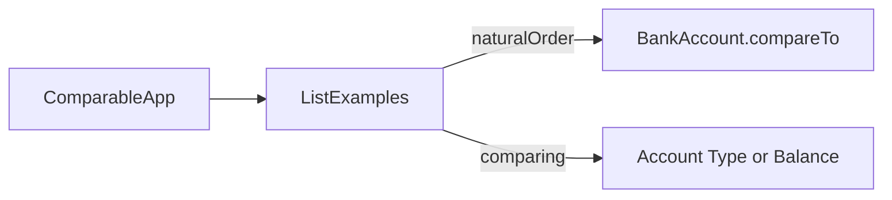

# Comparable and Comparator

Sorts strings and bank accounts using natural ordering and custom comparison rules.

## Responsibilities

1. **Application Entry Point (`ComparableApp`):** runs each sorting example and prints separators.
2. **Sorting Examples (`ListExamples`):** creates mutable lists and sorts them by different criteria.
3. **Natural Ordering (`BankAccount.compareTo`):** compares accounts by ID.
4. **Custom Ordering (`Comparator`):** supplies rules for account type, balance, and reversed ordering.

## Learning Notes

- `Comparable` defines a type's natural order through `compareTo()`; `Comparator` supplies an ordering from outside that type.
- Strings already have a natural order. `naturalOrder()` sorts the sample as A, B, C; `reverseOrder()` reverses it.
- The account-type comparator assigns personal accounts `0` and business accounts `1`, placing personal accounts first.
- `Comparator.comparing(account -> account.getBalance())` sorts by balance; natural account ordering uses ID instead.
- `List.sort()` changes the existing list. Each account sorting example operates on the same list.

## Concept Flow

## Implementation Flow

