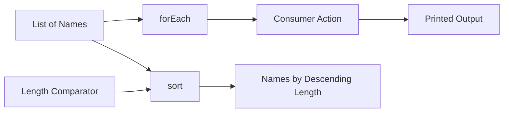
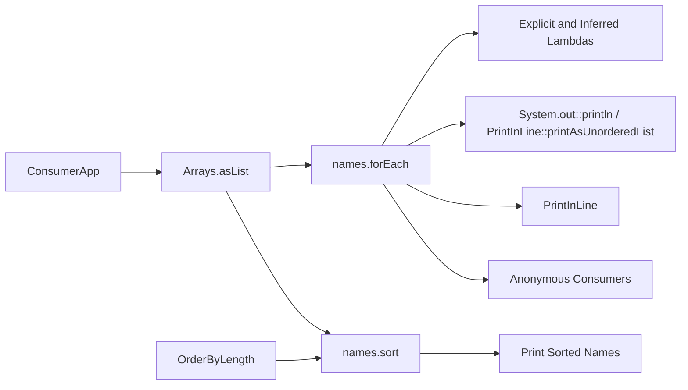

# Consumers and Custom Sorting

Demonstrates different ways to implement `Consumer<String>` for list iteration and uses a custom comparator to sort names by length.

## Responsibilities

1. **Action Contract (`Consumer<String>`):** accepts a string and performs an action without returning a result.
2. **Printing Action (`PrintInLine`):** implements `accept()` to print a name with a prefix and provides a static method for bullet-style output.
3. **Sorting Rule (`OrderByLength`):** compares strings by length in descending order.
4. **Application Entry Point (`ConsumerApp`):** applies lambdas, method references, and anonymous classes to a list, then sorts and prints it.

## Learning Notes

- `forEach()` calls `Consumer.accept()` for each element. Lambdas can declare the parameter type explicitly or let Java infer it.
- `System.out::println` references an instance method; `PrintInLine::printAsUnorderedList` references a static method.
- A named class or an anonymous class can implement `Consumer<String>`. The examples print first and last characters, full names, prefixed names, bullet-style names, duplicated names, and uppercase names.
- `Arrays.asList()` returns a fixed-size list that supports replacement and sorting, but not adding or removing elements.
- `OrderByLength` sorts longer names first, producing `[Charlie, Alice, Bob]`. The commented `Integer.compare(o1.length(), o2.length())` expression would instead sort by ascending length.
- `Consumer` performs an action; `Comparator` returns a negative, zero, or positive value to determine ordering. `sort()` changes the list in place.

## Concept Flow

## Implementation Flow

