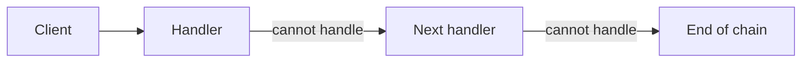
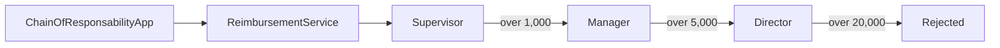

# Chain of Responsibility Pattern

Passes reimbursement requests through a chain of handlers until one can approve the amount or the chain ends.

## Responsibilities

1. **Application entry point (`ChainOfResponsabilityApp`)** builds the chain and sample requests, then sends each request to the service.
2. **Service (`ReimbursementService`)** receives the first handler and delegates each request to it.
3. **Handler interface (`ReimbursementHandler`)** defines the shared `process(Reimbursement)` contract.
4. **Base handler (`AbstractReimbursementHandler`)** checks whether a request can be approved, delegates it to the next handler when needed, and rejects it if the chain ends.
5. **Concrete handlers (`Supervisor`, `Manager`, `Director`)** define approval limits and print the corresponding approval message.
6. **Request (`Reimbursement`)** carries the amount and description and validates that the amount is positive and the description is not blank.

## Learning Notes

- The application assembles the chain as supervisor, manager, then director. The service only depends on the handler interface.
- Approval limits are inclusive: 1,000 for the supervisor, 5,000 for the manager, and 20,000 for the director.
- Each handler can receive a next handler through its constructor. A handler created without one ends the chain; an unapproved request is then rejected.
- The base handler formats approved amounts as US currency. Lombok generates its constructors; `force = true` initializes the final `next` field to `null` in the no-argument constructor.
- Constructors are not inherited, so each concrete handler declares the constructors that call the base class.

## Concept Flow

## Implementation Flow

## Running the Example

Run [ChainOfResponsabilityApp](ChainOfResponsabilityApp.java) from your IDE with Java 21.

| Sample | Amount | Result |
| --- | --- | --- |
| Office supplies | $500 | Approved by the supervisor |
| Travel expenses | $1,500 | Approved by the manager |
| Server maintenance | $6,000 | Approved by the director |
| Infrastructure upgrade | $12,000 | Approved by the director |
| Equipment purchase | $25,000 | Rejected after reaching the end of the chain |
