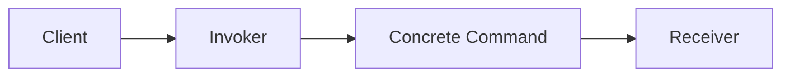
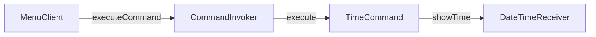

# Command Pattern

Encapsulates a request in an object so the invoker can execute commands through a shared interface.

## Responsibilities

1. **Client (`MenuClient`):** creates the objects, connects each command to the receiver, and sends the selected command to the invoker.
2. **Invoker (`CommandInvoker`):** calls `execute()` without knowing the operation's details.
3. **Command (`Command` interface):** defines the shared `execute()` method.
4. **Concrete Commands (`TimeCommand`, `DateCommand`, `DayOfWeekCommand`):** hold a reference to the receiver and delegate to `showTime()`, `showDate()`, or `showDayOfWeek()`.
5. **Receiver (`DateTimeReceiver`):** performs the operations to retrieve and display the time, date, and day of the week.
6. **Application Entry Point (`CommandApp`):** starts the menu and closes it using `try-with-resources`.

## Learning Notes

- `Command` provides a shared `execute()` contract, so the invoker can run different commands through the same interface.
- Each concrete command receives the receiver through its constructor and delegates to the corresponding operation. The date and time logic stays in `DateTimeReceiver`.
- `MenuClient` creates one receiver and one invoker, then creates a new command for each selected option. All three command types use the same receiver instance.
- The client knows the concrete commands; the invoker only needs the `Command` interface.
- `Client`, `Invoker`, and `Receiver` describe roles in the pattern. The class names and packages make those roles explicit for this exercise.
- `MenuClient` implements `AutoCloseable`; the try-with-resources block in `CommandApp` calls `close()`, which closes the scanner.

## Concept Flow

## Implementation Flow

