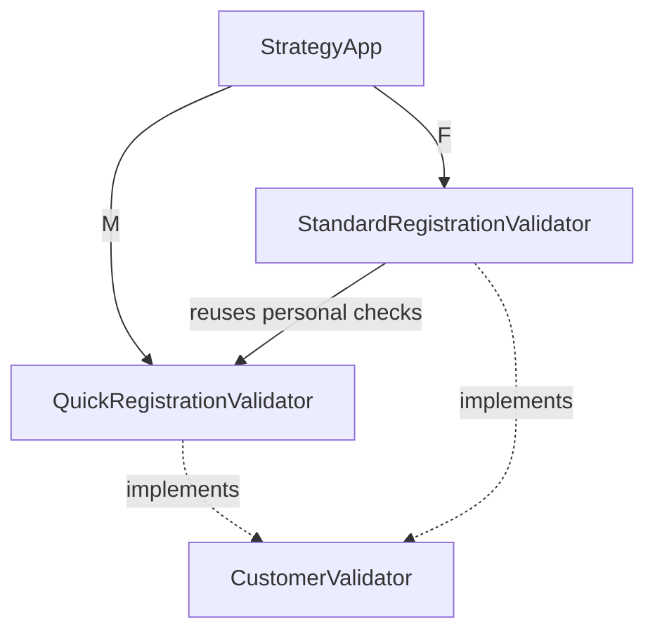
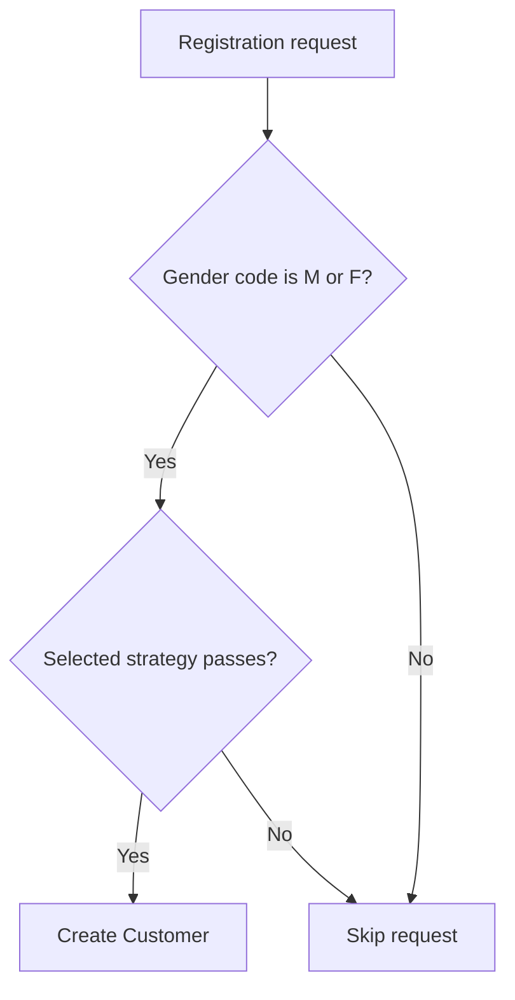

# Strategy Pattern

Defines interchangeable validation strategies for customer registration. The application validates the gender code, then uses it to select a strategy through a shared interface.

## Responsibilities

1. **Application entry point (`StrategyApp`)** builds the sample requests, filters out unsupported gender codes, and selects the validator for each remaining request.
2. **Strategy interface (`CustomerValidator`)** defines `validate(CustomerRegistrationRequest)` for strategies and individual field validators.
3. **Quick strategy (`QuickRegistrationValidator`)** checks the customer's name and birth date.
4. **Standard strategy (`StandardRegistrationValidator`)** reuses the quick strategy's checks and also validates the email address and phone number.
5. **Registration request (`CustomerRegistrationRequest`)** carries the input fields, including the raw gender code.
6. **Customer (`Customer`)** copies the accepted request into private final fields and converts the birth date and gender into `LocalDate` and `Gender`.

## Learning Notes

- The common gender check accepts `M` and `F`. The `switch` selects the quick strategy for `M` and the standard strategy for `F`. Both run through `validator.validate(request)`.
- Each strategy keeps its list of validators and uses `allMatch()` to stop at the first failed check.
- The standard strategy requires valid contact details in addition to the personal checks. In the sample, it rejects both of Jane Smith's requests because the email address is invalid.
- `StrategyApp` has a private constructor because it only exposes a static entry point. `Customer` has a public request constructor because `StrategyApp` calls it from another package.

## Concept Flow

## Implementation Flow

## Running the Example

Run [StrategyApp](StrategyApp.java) from your IDE with Java 21. Of the sample requests, only John Doe's produces a customer.

| Sample | Gender code | Strategy | Result |
| --- | --- | --- | --- |
| Jane Smith with an invalid email (two identical requests) | `F` | Standard | Both requests are rejected by the email validator. |
| John Doe with valid personal details | `M` | Quick | Accepted. |
| Alex Johnson | `OTHER` | Skipped | Rejected before strategy selection. |
