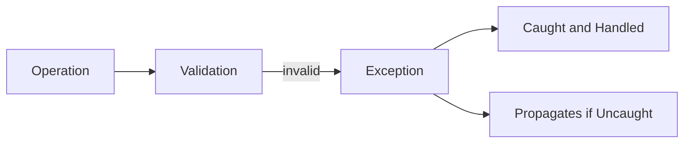
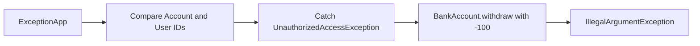

# Checked and Unchecked Exceptions

Demonstrates catching a custom exception and allowing an invalid withdrawal to raise an unchecked exception.

## Responsibilities

1. **Application Entry Point (`ExceptionApp`):** checks account ownership, catches an access exception, and attempts a negative withdrawal.
2. **Custom Access Exception (`UnauthorizedAccessException`):** carries an error message and extends `RuntimeException`.
3. **Account Validation (`BankAccount`):** rejects nonpositive withdrawals and insufficient funds with `IllegalArgumentException`.

## Learning Notes

- Checked exceptions must be caught or declared with `throws` when they can propagate from a method.
- Unchecked exceptions do not require `try/catch` or `throws`, but can still be caught.
- The source comment discusses checked exceptions, but `UnauthorizedAccessException` actually extends `RuntimeException`, so it is unchecked. Its catch block is optional to the compiler.
- The sample account ID and user ID differ, so the access error is caught and printed.
- The active `withdraw(-100)` call is outside a catch block and terminates this run with `IllegalArgumentException`. The commented alternative shows how to catch it.

## Concept Flow

## Implementation Flow

