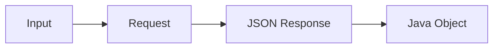
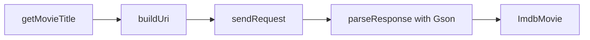

# HTTP Requests and JSON Responses

Searches OMDb for a movie title and maps the JSON response to a Java record.

## Responsibilities

1. **Request Coordinator (`HttpRequestApp`):** reads the title, builds the URI, sends the request, maps the response, and prints the movie.
2. **HTTP Transport (`HttpClient`):** sends the request and reads the response body as a string.
3. **JSON Mapper (`Gson`):** converts the response using an upper-camel-case naming policy.
4. **Response Model (`ImdbMovie`):** represents the movie fields and explicitly maps names such as `imdbRating`.

## Learning Notes

- The comments outline the process: obtain input and the API key, encode the title, build the URI, send the request, then parse the response.
- `OMDB_API_KEY` must be set in the environment. `buildUri()` calls `getApiKey()`; the key is not stored in the source.
- `URLEncoder.encode(..., UTF_8)` prepares the title for a query parameter.
- Typing `exit` invokes `System.exit(0)`, terminating the process with a success status.
- The client uses try-with-resources; I/O and interruption failures are wrapped in `RuntimeException`.
- `UPPER_CAMEL_CASE` handles fields such as `Title`; `@SerializedName` handles the API's exceptions to that naming rule.
- The code returns the response body directly; it does not separately validate HTTP status codes or OMDb error responses.

## Concept Flow

## Implementation Flow

