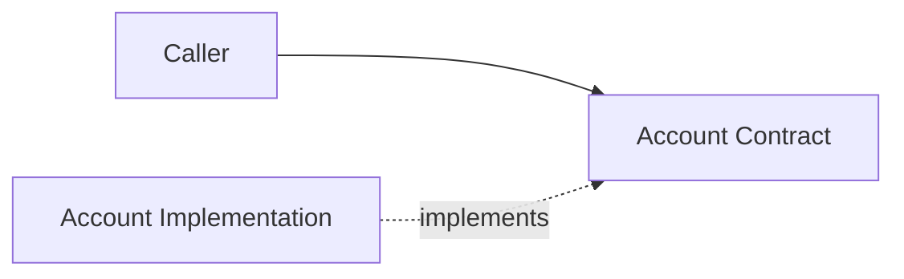
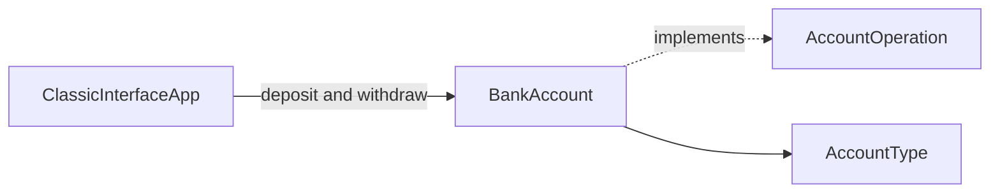

# Classic Interfaces

Defines a bank-account contract and implements deposits, withdrawals, and balance queries.

## Responsibilities

1. **Contract (`AccountOperation`):** declares `deposit()`, `withdraw()`, and `getBalance()`.
2. **Implementation (`BankAccount`):** stores account state, validates transactions, and implements the contract.
3. **Account Classification (`AccountType`):** defines business and personal accounts with their minimum scores.
4. **Application Entry Point (`ClassicInterfaceApp`):** creates two accounts and demonstrates deposits and withdrawals.

## Learning Notes

- The interface methods shown are implicitly `public abstract`; the commented modifiers are optional.
- Enum constructors are private; writing `private` explicitly is optional.
- `this.balance = balance` distinguishes the field from the parameter. In `balance = BigDecimal.ZERO`, there is no same-named parameter to disambiguate.
- `BigDecimal` operations return a new value, so the result of `add()` or `subtract()` is assigned back to the balance.
- `BankAccount` also implements `Comparable<BankAccount>` and uses ID as its natural ordering.

## Concept Flow

## Implementation Flow

