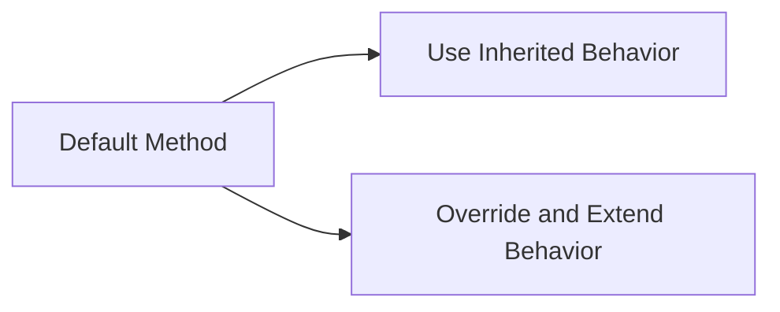
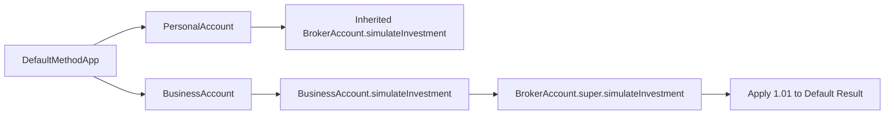

# Default Interface Methods

Shares an investment calculation through a default method and overrides it for business accounts.

## Responsibilities

1. **Default Behavior (`BrokerAccount`):** validates the amount and returns an investment value with a simulated 5% increase.
2. **Inherited Behavior (`PersonalAccount`):** extends `BankAccount` and uses the interface's default calculation.
3. **Overridden Behavior (`BusinessAccount`):** calls the default calculation and applies an additional multiplier.
4. **Application Entry Point (`DefaultMethodApp`):** prints the result for each account type.

## Learning Notes

- A `default` interface method has a body and is implicitly public.
- An implementing class can use the default method without redefining it, as `PersonalAccount` does.
- `BrokerAccount.super.simulateInvestment(amount)` calls the interface's default implementation from the override.
- The business calculation is `amount * 1.05 * 1.01`. For `100`, the result is `106.05`: the extra 1% compounds on the default result.
- The default method rejects zero and negative amounts before calculating the return.

## Concept Flow

## Implementation Flow

