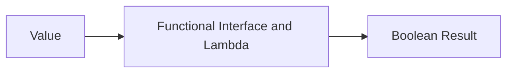
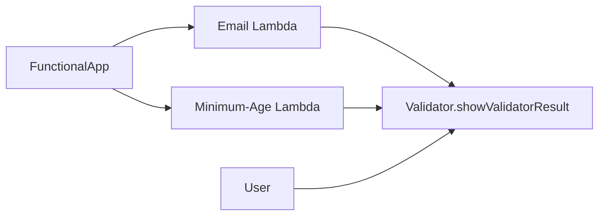

# Functional Interfaces and Lambdas

Represents validation rules as lambdas through a generic functional interface.

## Responsibilities

1. **Validation Contract (`Validator<T>`):** declares the single abstract method `isValid(T value)`.
2. **Result Printer (`Validator.showValidatorResult`):** receives a value and a validator, executes the rule, and prints the result.
3. **Validated Data (`User`):** stores an email address and a birth date.
4. **Application Entry Point (`FunctionalApp`):** defines email and minimum-age validators and applies both to sample users.

## Learning Notes

- `@FunctionalInterface` is optional, but makes the compiler reject an additional abstract method. The static helper does not count as an abstract method.
- `T` is a generic type parameter. Names such as `T`, `E`, `K`, and `V` are conventions, not reserved identifiers; a descriptive name is also valid.
- The parameter name in `isValid(T value)` is independent of the generic type name.
- A block lambda uses braces and an explicit `return`; an expression lambda returns its expression directly.
- The email rule uses `contains()` for the sample domain. It is a demonstration, not complete email validation.
- The age rule accepts birth dates on or before `LocalDate.now().minusYears(18)`. `LocalDate` is an immutable date type from the Java 8 date/time API.

## Concept Flow

## Implementation Flow

