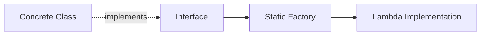
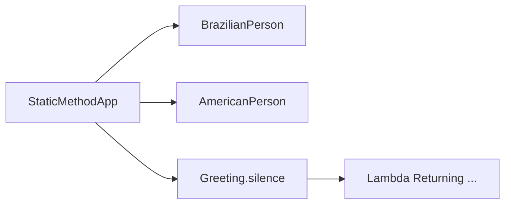

# Static Interface Methods

Combines interface implementations with a static factory method that returns a lambda implementation.

## Responsibilities

1. **Greeting Contract (`Greeting`):** declares `sayHello(String phrase)`.
2. **Static Factory (`Greeting.silence`):** returns a greeting that always produces `...`.
3. **Concrete Greetings (`BrazilianPerson`, `AmericanPerson`):** implement greetings in Portuguese and English.
4. **Application Entry Point (`StaticMethodApp`):** stores all three implementations as `Greeting` references and prints their results.

## Learning Notes

- Call the static method through the interface name: `Greeting.silence()`.
- Static interface methods are not inherited as instance methods by implementing classes.
- The lambda `phrase -> "..."` implements `sayHello()` and intentionally ignores the supplied phrase.
- The interface has one abstract method, so it can be implemented with a lambda even without `@FunctionalInterface`.

## Concept Flow

## Implementation Flow

