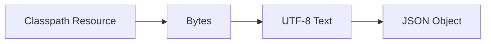
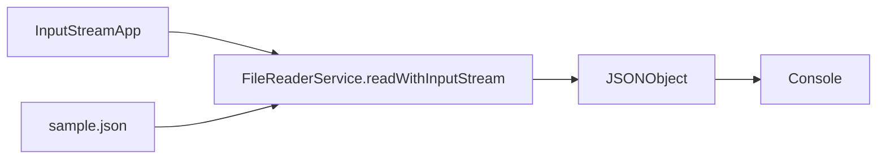

# Reading Classpath Resources

Reads a JSON file from the application resources and parses its contents as a JSON object.

## Responsibilities

1. **Application Entry Point (`InputStreamApp`):** requests `sample.json`, creates a `JSONObject`, and prints it.
2. **Resource Reader (`FileReaderService`):** opens a classpath resource, reads its bytes, and decodes them as UTF-8.
3. **JSON Representation (`JSONObject`):** parses the returned text into a JSON object.

## Learning Notes

- As the reader's comment explains, `getResourceAsStream()` expects a classpath resource. In this project, `sample.json` comes from `app/src/main/resources`.
- Pass the resource name, not an absolute filesystem path.
- A missing resource returns null; the helper converts that condition into `IOException` before reading it.
- Try-with-resources closes the input stream automatically. `readAllBytes()` reads the complete resource into memory.
- The app catches `IOException` and prints its message. JSON parsing errors are not handled by that catch block.

## Concept Flow

## Implementation Flow

