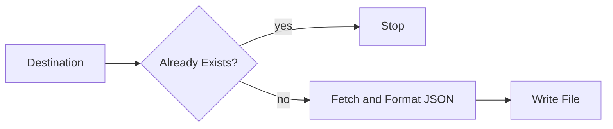
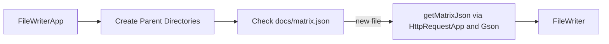

# Writing JSON Files

Fetches the movie Matrix from OMDb, formats its JSON, and writes it to a local file.

## Responsibilities

1. **Application Entry Point (`FileWriterApp`):** prepares the destination, checks whether it exists, and writes the content.
2. **HTTP Helper (`HttpRequestApp`):** builds the OMDb URI and retrieves the response body.
3. **JSON Formatter (`Gson`):** parses the response and serializes it with pretty printing.
4. **Text Output (`FileWriter`):** writes the JSON to `docs/matrix.json` and closes automatically.

## Learning Notes

- The comments emphasize creating parent directories before opening the writer.
- The existing-file check returns immediately, so this example does not overwrite an existing `matrix.json` or make the API request in that case.
- `getMatrixJson()` reads JSON into `Object` and serializes it again to apply indentation.
- The reused HTTP helper requires the `OMDB_API_KEY` environment variable.
- The destination is relative to the working directory. This `FileWriter` constructor uses the JVM's default charset.
- The writer is managed by try-with-resources; failures inside that block are caught and printed.

## Concept Flow

## Implementation Flow

