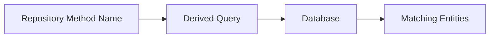
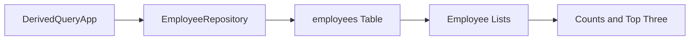

# JPA Derived Queries

Builds database queries from repository method names and prints employee counts and rankings.

## Responsibilities

1. **Application and Startup Task (`DerivedQueryApp`):** executes repository queries from `ApplicationRunner.run()` and prints their results.
2. **Query Contract (`EmployeeRepository`):** declares methods whose names describe filtering, ordering, and result limits.
3. **Entity (`Employee`):** maps employee attributes to the `employees` table.
4. **Enum (`Gender`):** supplies the gender values stored as strings.

## Learning Notes

- Derived query names use Java entity properties, such as `vacationHours` and `jobTitle`, rather than database column names.
- `findByGender()` selects a value; `findByGenderIsNot()` selects values that differ from it.
- `IsGreaterThan`, `LikeIgnoreCase`, and `EqualsIgnoreCase` express comparison and text-matching rules.
- `And` combines predicates; `findTop3ByOrderByVacationHoursDesc()` orders descending and limits the results to three.
- `LikeIgnoreCase("%Design%")` uses `%` wildcards for the sample substring search.
- The current counts use `.size()` on loaded lists. The variable named `totalFemale` actually counts `gender != M`, and the designers variable only queries `%Design%`.

## Concept Flow

## Implementation Flow

