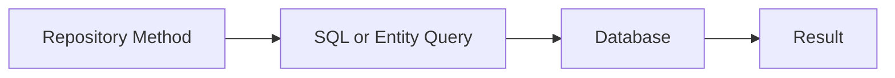
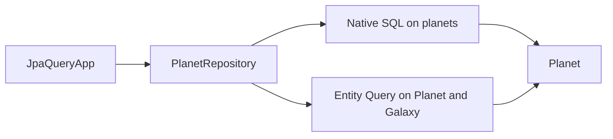

# Explicit JPA Queries

Defines repository queries explicitly with native SQL and entity-based JPQL/HQL expressions.

## Responsibilities

1. **Application and Startup Task (`JpaQueryApp`):** calls the query methods and prints planets and filtered lists.
2. **Query Definitions (`PlanetRepository`):** declares `@Query` statements and named parameters.
3. **Planet Entity (`Planet`):** maps planet data and its many-to-one galaxy relationship.
4. **Galaxy Entity (`Galaxy`):** maps galaxies and the inverse collection of planets.

## Learning Notes

- `nativeQuery = true` runs SQL using physical names such as `planets` and `moon_count`.
- Entity queries use names such as `Planet`, `p.moonCount`, and `p.galaxy`, rather than table and column names.
- `:moonCount` and `:size` are named parameters supplied by the repository method arguments.
- `JOIN p.galaxy g` follows the mapped relationship to filter planets by galaxy size.
- Despite its name, `getBiggerPlanetWithNativeQuery()` orders by `moon_count DESC`, so it selects the planet with the most moons, not the largest size.
- The smallest-planet query uses `LIMIT 1` in an entity query; that syntax depends on the Hibernate HQL extension rather than portable JPQL.
- `Planet.toString()` prints the galaxy name, and its galaxy relationship explicitly uses eager fetching.

## Concept Flow

## Implementation Flow

