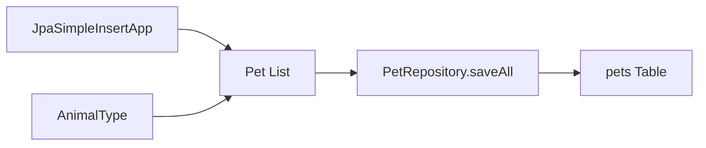

# Simple JPA Inserts

Creates two pet entities and saves them together through a Spring Data repository.

## Responsibilities

1. **Application and Startup Task (`JpaSimpleInsertApp`):** starts Spring Boot, creates the sample pets, and calls `saveAll()` from `CommandLineRunner.run()`.
2. **Entity (`Pet`):** maps pet data to the `pets` table.
3. **Classification (`AnimalType`):** defines the supported animal types.
4. **Repository (`PetRepository`):** inherits persistence operations from `JpaRepository<Pet, Long>`.

## Learning Notes

- Constructor injection supplies the repository; the app does not create a repository implementation manually.
- New pets use constructors without IDs. `@GeneratedValue(strategy = AUTO)` delegates identifier generation to JPA and the database setup.
- `@Enumerated(EnumType.STRING)` stores enum names rather than numeric positions.
- `@Transient` excludes `hasHealthPlan` from persistence.
- `saveAll(pets)` persists the sample list. Running this startup task performs database writes.
- The example uses the project's shared datasource configuration; it does not define a separate connection inside the package.

## Concept Flow

## Implementation Flow

