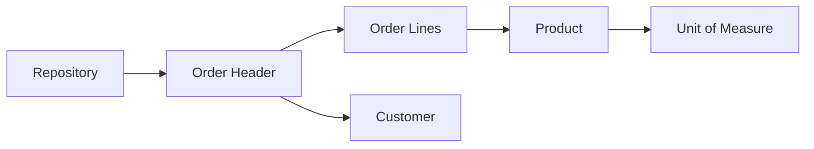
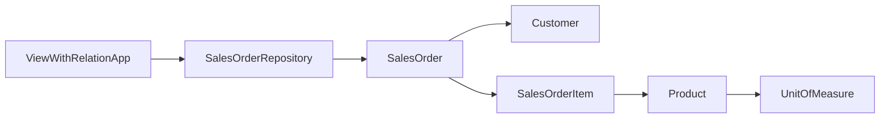

# JPA Relationships with Legacy Tables

Maps Protheus-style tables to related entities and loads sales orders with their associated data.

## Responsibilities

1. **Application and Startup Task (`ViewWithRelationApp`):** loads all sales orders through the repository and prints them.
2. **Order Models (`SalesOrder`, `SalesOrderItem`):** map order headers and lines to `SC5990` and `SC6990`.
3. **Related Models (`Customer`, `Product`, `UnitOfMeasure`):** map customers, products, and units to `SA1990`, `SB1990`, and `SAH990`.
4. **Composite Keys (`*Id` classes):** group the identifier fields used by each entity's `@IdClass`.
5. **Text Converter (`TrimTrailingConverter`):** strips trailing spaces from converted text when reading it.
6. **Repositories (`SalesOrderRepository`, `ProductRepository`):** provide access using the composite key types.

## Learning Notes

- The join comments are easiest to remember by location: `@JoinColumn.name` names the foreign-key column, and `referencedColumnName` names the column it points to.
- For `Product.unitOfMeasure` (`ManyToOne`), that is `Product.B1_UM -> UnitOfMeasure.AH_UNIMED`. For the unidirectional `SalesOrder.items` (`OneToMany`), the foreign keys are on the item table: `C6_FILIAL/C6_NUM -> C5_FILIAL/C5_NUM`.
- `@IdClass` combines fields such as branch, order number, and item sequence. The ID classes supply matching fields and equality methods.
- `TrimTrailingConverter` is applied to selected name/description fields. Its read conversion uses `stripTrailing()`; its write conversion returns the value unchanged.
- The product comment warns about converting identifiers. The current ID fields have no converter or trimming getter, so do not assume their padding has been removed.
- `SalesOrder.items` intentionally uses `FetchType.EAGER` for this exercise, as its comment explains. Treat it as an example choice rather than a universal fetching rule.
- The numeric mapping comment explains `@JdbcTypeCode(SqlTypes.DOUBLE)`: the legacy database uses floating-point columns while the Java fields remain `BigDecimal`. This mapping does not make stored floating-point values exact decimals.
- Although the app name says “View”, these entities currently use `@Table`. The mappings and joins depend on the actual legacy schema and data.

## Concept Flow

## Implementation Flow

