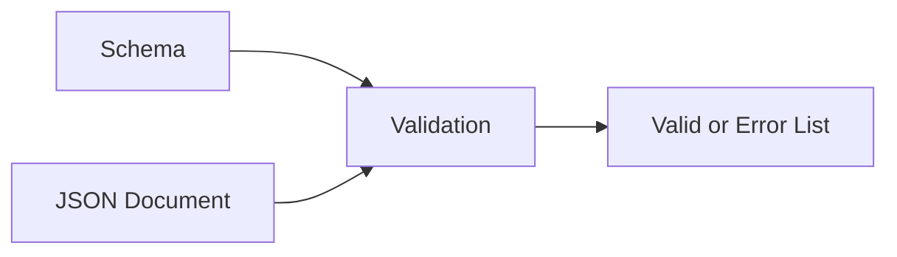
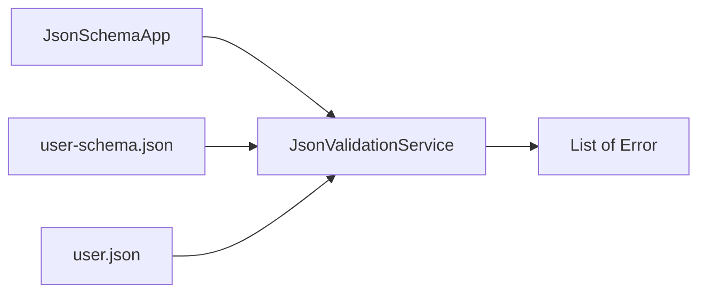

# JSON Schema Validation

Validates a JSON resource against a Draft 2020-12 schema and prints any validation errors.

## Responsibilities

1. **Application Entry Point (`JsonSchemaApp`):** sets the locale, chooses the files, runs validation, and displays the result.
2. **Schema Validator (`JsonValidationService`):** loads the schema once and validates JSON text against it.
3. **Validation Rules (`user-schema.json`):** defines allowed properties, types, required fields, and value constraints.
4. **Input Data (`user.json`):** provides the document to validate from the resources folder.

## Learning Notes

- The app sets `Locale.ENGLISH` to make validation messages consistent, as noted in its comments.
- An empty `List<Error>` means the schema validator found no errors; otherwise the app prints each message.
- The schema requires `id`, `name`, `birthDate`, and `isActive`, and rejects additional properties.
- Other rules include `enum`, `const`, minimum values, and a birth-date pattern. The pattern checks the `YYYY-MM-DD` shape, not whether the date exists on the calendar.
- `SchemaRegistry` uses `DRAFT_2020_12`, matching the schema resource.
- Both files are loaded from the classpath; streams close automatically and text is decoded as UTF-8.

## Concept Flow

## Implementation Flow

