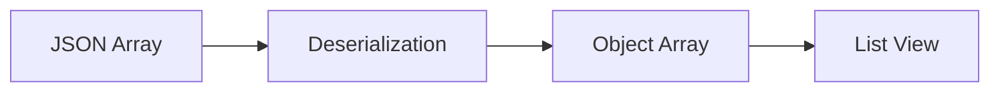
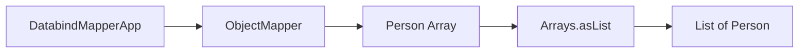

# Jackson Array Deserialization

Deserializes a JSON array into Java objects and exposes the resulting array as a list.

## Responsibilities

1. **Application Entry Point (`DatabindMapperApp`):** defines the JSON text, deserializes it, converts the array to a list, and prints it.
2. **JSON Mapper (`tools.jackson.databind.ObjectMapper`):** maps the JSON array to `Person[]`.
3. **Target Model (`Person`):** supplies name fields, a no-argument constructor, setters, and an Optional middle-name getter.
4. **List Adapter (`Arrays.asList`):** returns a list backed by the resulting array.

## Learning Notes

- The source comment highlights deserialization: converting JSON text into Java objects.
- `Person[].class` supplies the array element type to `readValue()`; an untyped `List.class` would not describe `Person` elements.
- `Arrays.asList(personArray)` produces a fixed-size list backed by the array; it does not support adding or removing elements.
- The text block contains the JSON sample directly in the Java source.
- This example imports Jackson 3's `tools.jackson.databind.ObjectMapper`; the shared `mapper/EntityMapper` helper imports Jackson 2's `com.fasterxml.jackson.databind.ObjectMapper` instead.

## Concept Flow

## Implementation Flow

