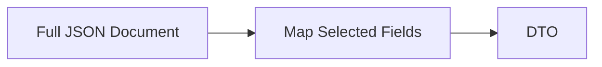
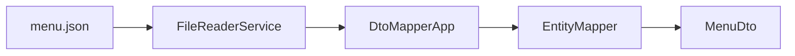

# Mapping JSON to a DTO

Reads a menu resource and maps only the fields needed by a smaller data-transfer object.

## Responsibilities

1. **Application Entry Point (`DtoMapperApp`):** loads the JSON, requests the mapping, and prints the DTO.
2. **Resource Reader (`FileReaderService`):** reads `menu.json` from the classpath as UTF-8 text.
3. **JSON Mapper (`EntityMapper`):** deserializes the text into the requested Java type.
4. **Transfer Object (`MenuDto`):** exposes only ID, title, and description.

## Learning Notes

- A DTO can represent a subset of a larger JSON document.
- `@JsonIgnoreProperties(ignoreUnknown = true)` allows the other menu fields to be ignored.
- `@JsonAlias("name")` accepts the JSON property `name` as input for the Java component `title`.
- `mapEntity(menuData, MenuDto.class)` supplies the target type through `Class<T>` and returns that type.
- The record defines a compact data carrier. Resource-reading failures are wrapped by the app; mapping failures are wrapped by the helper.

## Concept Flow

## Implementation Flow

