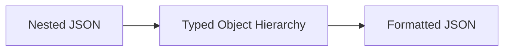
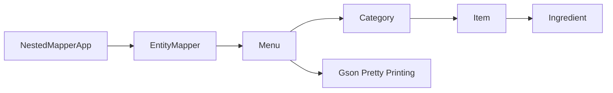

# Nested JSON Mapping

Maps a nested menu document into a hierarchy of records and prints the result as formatted JSON.

## Responsibilities

1. **Application Entry Point (`NestedMapperApp`):** loads the resource, maps it, and prints pretty JSON.
2. **JSON Mapper (`EntityMapper`):** deserializes `menu.json` using Jackson.
3. **Root Model (`Menu`):** holds menu details, currency, and categories.
4. **Nested Models (`Category`, `Item`, `Ingredient`):** represent category items, item details, and ingredient lists.
5. **Value Types (`MeasureUnit`, `Allergen`):** represent ingredient units and allergens as enums.
6. **Output Formatter (`Gson`):** serializes the mapped object with pretty printing.

## Learning Notes

- A nested JSON structure can be mirrored with records containing other records and typed lists.
- The hierarchy is `Menu -> Category -> Item -> Ingredient`; ingredient allergens form another list.
- `Item.price` uses `BigDecimal`, while ingredient quantity uses `double`.
- Jackson performs the input mapping; Gson handles the output formatting in this example.
- `FileReaderService` supplies UTF-8 text from the classpath resource, rather than a filesystem path.

## Concept Flow

## Implementation Flow

