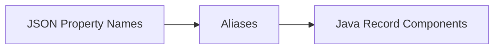
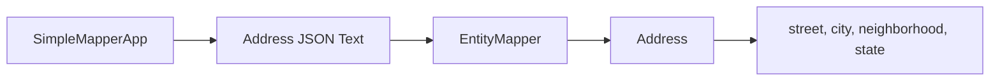

# Simple JSON Mapping

Maps an address JSON object to an English-named Java record using property aliases.

## Responsibilities

1. **Application Entry Point (`SimpleMapperApp`):** defines the sample JSON, maps it, and prints the address fields.
2. **JSON Mapper (`EntityMapper`):** uses Jackson to convert JSON text into the requested class.
3. **Target Record (`Address`):** represents street, city, neighborhood, and state.

## Learning Notes

- `@JsonAlias` accepts a different JSON input name: `logradouro -> street`, `localidade -> city`, `bairro -> neighborhood`, and `uf -> state`.
- `@JsonIgnoreProperties(ignoreUnknown = true)` skips JSON properties that the record does not declare.
- `Address.class` tells the generic mapper which type to construct.
- Record accessors use component names such as `address.street()`, rather than JavaBean-style `getStreet()`.
- Aliases perform name mapping; they do not validate whether the address values are consistent with one another.

## Concept Flow

## Implementation Flow

