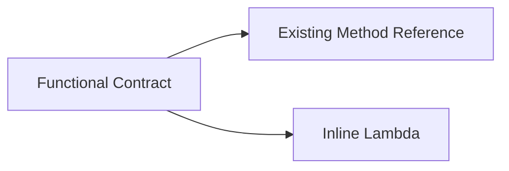
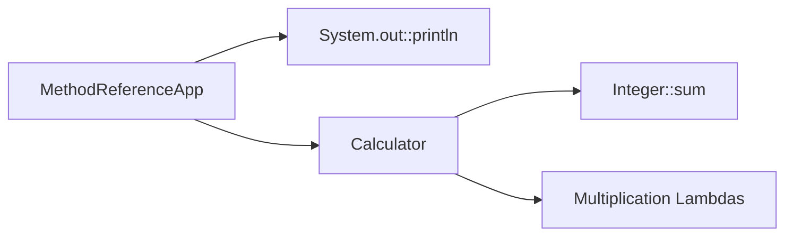

# Method References

Uses existing methods as functional-interface implementations and compares them with expression and block lambdas.

## Responsibilities

1. **Calculation Contract (`Calculator`):** declares `calculateToValues(int a, int b)`.
2. **Reusable Operation (`Integer.sum`):** supplies addition through a static method reference.
3. **Custom Operations (Lambdas):** implement multiplication and a calculation with conditional logic.
4. **Application Entry Point (`MethodReferenceApp`):** prints lists and executes each calculator.

## Learning Notes

- `System.out::println` refers to a method on the existing `System.out` object; `forEach()` supplies each element as its argument.
- `Integer::sum` refers to a static method matching the calculator's two-argument signature.
- A method reference reuses an existing method; a lambda lets you write the behavior inline.
- A block lambda supports local variables, conditions, and an explicit `return`.
- The complex example applies `Math.round(result * 0.15f)` only when the multiplication result is greater than `10`.

## Concept Flow

## Implementation Flow

