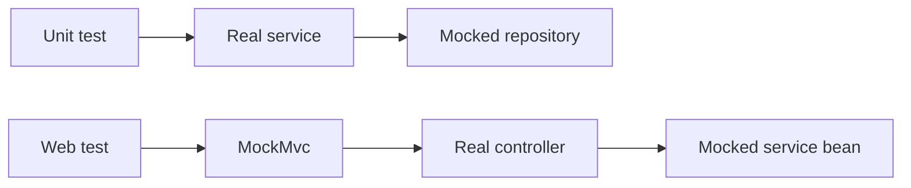
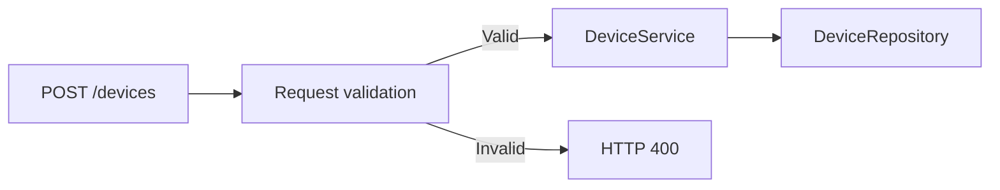

# Mockito Dependency Injection

Examples of testing the device service and controller with Mockito and Spring MVC.

## Responsibilities

1. **Entity (`Device`):** maps device data to the `devices` table.
2. **Repository (`DeviceRepository`):** provides persistence operations through `JpaRepository`.
3. **Service (`DeviceService`):** looks up and creates devices using the repository.
4. **Controller (`DeviceController`):** exposes device endpoints and validates creation requests.
5. **Application (`MockitoInjectApp`):** starts the Spring Boot application.

## Learning Notes

- `DeviceServiceInjectMocksTest` uses `@InjectMocks` to create a real service with a mocked repository. Its current stubbing calls the real service methods during setup; the exception test also configures an exception but expects an empty result.
- `DeviceControllerTest` creates a real controller and service manually, with a mocked repository. It captures the device passed to `save`.
- `DeviceControllerInjectMocksTest` uses `@InjectMocks` to create a real controller and inject a mocked service. It checks the returned status and body and verifies the service call, without starting Spring or a database.
- `DeviceControllerWebTest` uses `@WebMvcTest`, `MockMvc` and `@MockitoBean` to test the HTTP layer. It checks that a negative price produces HTTP 400 and does not call the service.
- `@InjectMocks` is a Mockito feature for constructing an object in a unit test. `@MockitoBean` replaces a bean in the Spring test context.
- Calling a controller directly does not run Spring MVC request validation; use `MockMvc` to exercise `@Valid` on an HTTP request.
- The configured PostgreSQL profile uses `spring.jpa.hibernate.ddl-auto=create`; starting the full application context with that profile can recreate tables.

## Concept Flow

## Implementation Flow

