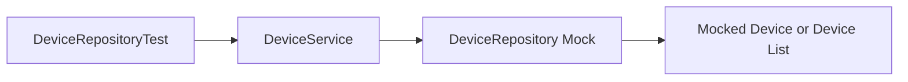

# Mockito Dependency Injection

Tests device lookup in a service using a mocked repository injected by Mockito.

## Responsibilities

1. **Entity (`Device`):** maps device data to the `devices` table.
2. **Repository (`DeviceRepository`):** inherits persistence operations from `JpaRepository<Device, Long>`.
3. **Service (`DeviceService`):** delegates device lookups to the repository.
4. **Test (`DeviceServiceTest`):** checks the service with a mocked repository and mocked devices.
5. **Application (`MockitoInjectApp`):** starts Spring Boot and prints a device and the list of devices using the
   service.

## Learning Notes

- `@ExtendWith(MockitoExtension.class)` enables Mockito annotations for the JUnit tests.
- `@Mock` creates substitutes for the repository and a device. `@InjectMocks` creates the service and injects the mocked
  repository.
- The service is real in the test, but the repository is a mock, so the test does not connect to a database or start
  Spring.
- `shouldFindDeviceById` checks that the result for ID `1` is present; it does not check the device fields.
- `shouldFindThreeDevices` uses a real list containing three mocked devices and checks its size.
- The current `given(...)` calls execute service methods during setup, which delegate to the mocked repository.
  Configuring `repository.findById(...)` and `repository.findAll()` directly makes the mocked behavior explicit.
- `MockitoInjectApp` is separate from the unit tests and uses the configured datasource when run.

## Concept Flow

## Implementation Flow

