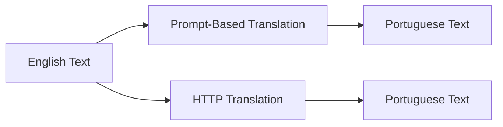
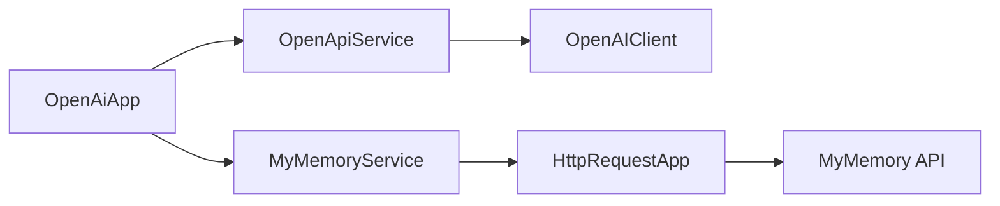

# Text Translation with Two Services

Translates the same English text to Brazilian Portuguese using OpenAI and MyMemory, then prints both responses.

## Responsibilities

1. **Application Entry Point (`OpenAiApp`):** configures UTF-8 console output and calls both translation services sequentially.
2. **Prompt-Based Translator (`OpenApiService`):** builds a translation prompt and sends it through the OpenAI Java client.
3. **HTTP-Based Translator (`MyMemoryService`):** builds a translation URL, sends the request, and extracts the translated text from JSON.
4. **Shared HTTP Helper (`HttpRequestApp.sendRequest`):** retrieves the MyMemory response body.

## Learning Notes

- The first comment concerns console encoding: the app replaces `System.out` with a UTF-8 `PrintStream`. This configures that output stream, not every encoding setting in the JVM.
- `OpenApiService` checks `OPENAI_API_KEY` and creates the client with `OpenAIOkHttpClient.fromEnv()`.
- `translateToBrazilianPortuguese()` builds a prompt and delegates to `sendPrompt()`. The current source selects `GPT_5_4_MINI`, low verbosity and reasoning effort, and a 1000-token completion limit.
- The response uses the first choice and falls back to an empty string if its message content is absent.
- MyMemory uses URL-encoded text and the language pair `en|pt-br`, then reads `responseData.translatedText` when present.
- The calls are sequential: an uncaught failure in the OpenAI call prevents the MyMemory call from running.

## Concept Flow

## Implementation Flow

