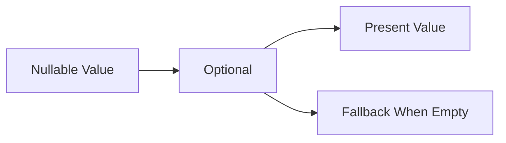
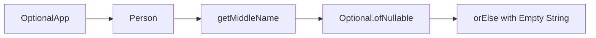

# Optional and Constructor Chaining

Represents an optional middle name and supplies a fallback when displaying it.

## Responsibilities

1. **Person Model (`Person`):** stores names and exposes the middle name as `Optional<String>`.
2. **Overloaded Constructor (`Person(String, String)`):** accepts first and last names and delegates to the three-argument constructor.
3. **Application Entry Point (`OptionalApp`):** creates a person without a middle name and prints the names.

## Learning Notes

- Constructor overloading provides different parameter lists for creating the same type.
- Constructor chaining uses `this(firstName, null, lastName)` to reuse initialization.
- `Optional.ofNullable(middleName)` returns an empty Optional when the field is null.
- `orElse("")` supplies an empty string when no middle name is present.
- The field remains a nullable `String`; the getter wraps it in Optional. Lombok supplies constructors and other boilerplate declared by the annotations.

## Concept Flow

## Implementation Flow

