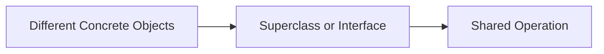
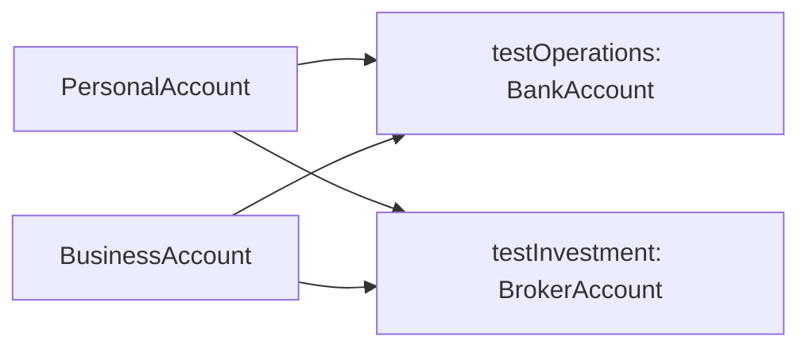

# Polymorphism

Uses superclass and interface parameters to work with different account implementations through shared types.

## Responsibilities

1. **Application Entry Point (`PolymorphismApp`):** creates personal and business accounts and passes both to shared methods.
2. **Superclass-Based Operation (`testOperations`):** accepts a `BankAccount` and performs deposits and withdrawals.
3. **Interface-Based Operation (`testInvestment`):** accepts a `BrokerAccount` and calls `simulateInvestment()`.
4. **Concrete Types (`PersonalAccount`, `BusinessAccount`):** inherit account operations and provide inherited or overridden investment behavior.

## Learning Notes

- As the comments emphasize, `testOperations(BankAccount account)` accepts subclasses of `BankAccount`.
- `testInvestment(BrokerAccount account, ...)` accepts objects implementing `BrokerAccount`, even if their inheritance hierarchy differs.
- Both sample account types satisfy both parameters, so the caller does not need separate methods for each concrete class.
- The runtime object determines which overridden instance method executes: business accounts use their investment override.

## Concept Flow

## Implementation Flow

