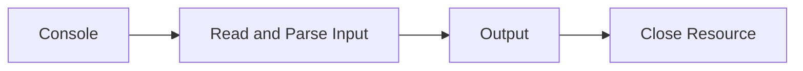
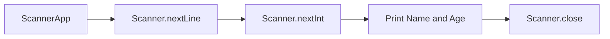

# Console Input with Scanner

Reads a name and an age from the console and prints them in a sentence.

## Responsibilities

1. **Input Reader (`Scanner`):** reads a full line with `nextLine()` and an integer with `nextInt()`.
2. **Application Entry Point (`ScannerApp`):** asks the questions, stores the answers, and prints the result.
3. **Resource Management (`try (sc)`):** closes the previously declared scanner when the block ends.

## Learning Notes

- `System.in` is the input source; `Scanner` parses the values read from it.
- `nextLine()` reads the name including spaces. `nextInt()` expects a valid integer.
- `try (sc)` can use a previously declared variable that is final or effectively final.
- Closing this scanner also closes `System.in`, which is appropriate here because the console example ends afterward.
- If another `nextLine()` were added after `nextInt()`, account for the newline left after the number.

## Concept Flow

## Implementation Flow

