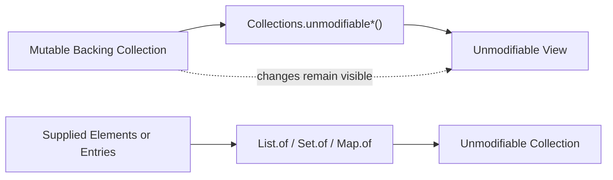
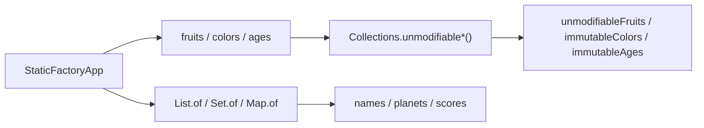

# Static Collection Factories

Compares unmodifiable views created with `Collections.unmodifiable*()` with the collection factory methods available since Java 9.

## Responsibilities

1. **Mutable Backing Collections (`ArrayList`, `TreeSet`, `HashMap`):** store fruits, sorted colors, and ages.
2. **Unmodifiable Views (`Collections.unmodifiableList`, `Collections.unmodifiableSet`, `Collections.unmodifiableMap`):** expose the backing collections without allowing changes through the views.
3. **Collection Factories (`List.of`, `Set.of`, `Map.of`):** create unmodifiable collections directly from the supplied elements or entries.
4. **Application Entry Point (`StaticFactoryApp`):** creates examples of each approach without printing or attempting modifications.

## Learning Notes

- Static factory methods, such as `List.of()`, return objects without a direct constructor call.
- `Collections.unmodifiable*()` predates Java 9 and creates views that reflect changes to their backing collections.
- The `TreeSet` view keeps its sorted order.
- Since Java 9, `List.of()`, `Set.of()`, and `Map.of()` create unmodifiable collections and reject nulls.
- `List.of()` preserves order and allows duplicates.
- `Set.of()` rejects duplicate elements.
- `Map.of()` rejects duplicate keys but allows duplicate values.
- Unmodifiable does not mean deeply immutable: contained objects may still be mutable: Mutation operations such as `add()`, `put()`, or `remove()` are unsupported.

## Concept Flow

## Implementation Flow

