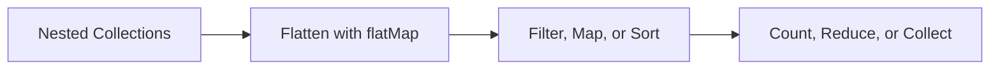
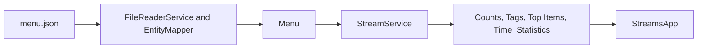

# Streams and Collection Operations

Queries a nested menu with streams, lambdas, method references, and BigDecimal statistics.

## Responsibilities

1. **Application Entry Point (`StreamsApp`):** loads `menu.json`, maps it to `Menu`, and prints each operation's result.
2. **Collection Operations (`StreamService`):** gathers items, filters data, extracts tags, ranks prices, and totals preparation times.
3. **Input Model (`Menu`, `Category`, `Item`):** provides the nested collections used by the examples.
4. **Price Collector (`Collectors2`, `BigDecimalSummaryStatistics`):** calculates count, sum, minimum, maximum, and average prices using Eclipse Collections.

## Learning Notes

- `getAllItems()`: create a mutable list, visit each category, and add its items to that list. This is the imperative example described in the comments.
- `getItemsWithPriceOver40()`: stream categories, flatten item lists with `flatMap()`, filter prices greater than `40`, then `count()`. It returns a count, despite the method's name.
- `getTagsToRemove()`: flatten items, keep unavailable ones, flatten their tags, remove duplicates with `distinct()`, and collect with `toList()`. It does not remove tags from the menu.
- `getTopExpensiveItems()`: flatten items, sort by price descending, keep the first three with `limit(3)`, and collect.
- `getTimeToPrepareAllItems()`: flatten items, map each preparation time, and sum with `reduce(0, Integer::sum)`.
- `getPriceStatistics()`: gather all items and collect their prices with `Collectors2.summarizingBigDecimal(Item::price)`.
- The app rounds the displayed average to two decimal places with `RoundingMode.HALF_UP`.

## Concept Flow

## Implementation Flow

