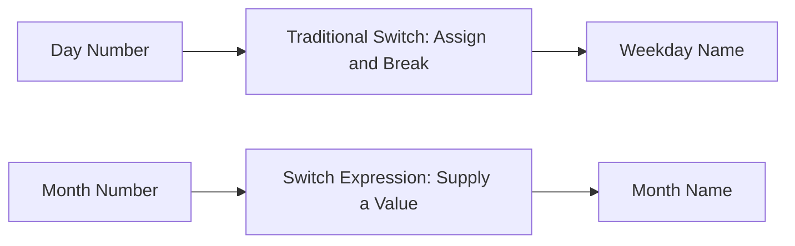
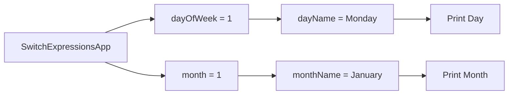

# Switch Expressions

Converts numbers into weekday and month names using a traditional switch statement and a switch expression.

## Responsibilities

1. **Application Entry Point (`SwitchExpressionsApp`):** runs both examples and prints their names.
2. **Traditional Switch Example (`dayOfWeek`, `dayName`):** maps numbers from `1` (Monday) through `7` (Sunday) to weekday names.
3. **Switch Expression Example (`month`, `monthName`):** maps numbers from `1` (January) through `12` (December) to month names.

## Learning Notes

- Traditional switch statements have been available since Java 1.0, released in 1996.
- A traditional switch uses `case` labels followed by a colon.
- `break` stops execution from continuing into the next case, a behavior called fall-through.
- Switch expressions debuted as a preview in Java 12, received a second preview in Java 13, and became standard in Java 14.
- Change `dayOfWeek` and `month` to try other names. Both start at `1`, producing:

```text
Day: Monday
Month: January
```

## Concept Flow



## Implementation Flow


