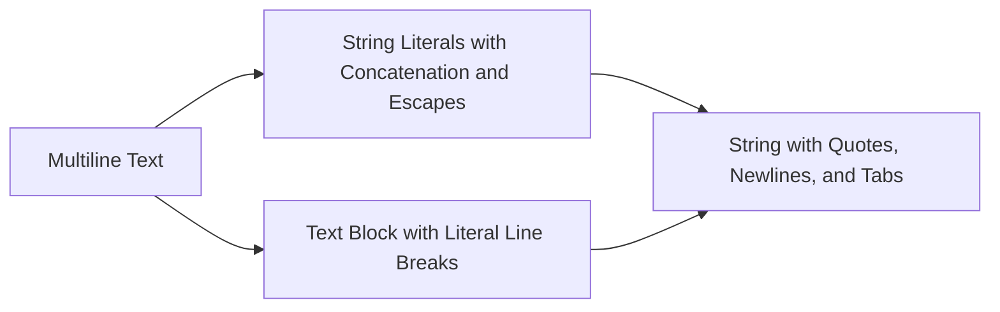
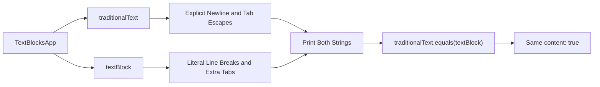

# Text Blocks

Builds the same multiline passage with traditional string literals and a text block, showing how quotes, line breaks, and indentation affect the resulting `String`.

## Responsibilities

1. **Application Entry Point (`TextBlocksApp`):** creates and prints both string representations, then compares their contents.
2. **Traditional String Example (`traditionalText`):** combines string literals with `+` and uses escapes for quotes, newlines, and tabs.
3. **Text Block Example (`textBlock`):** writes the same passage from [Psalm 23:1-4 (New International Version)](https://www.biblegateway.com/passage/?search=Psalm+23%3A1-4&version=NIV) with literal line breaks and additional indentation on two lines.
4. **Content Comparison (`String.equals`):** checks that both strings contain exactly the same characters, including whitespace.

## Learning Notes

- Text blocks debuted as a preview in Java 13, received a second preview in Java 14, and became standard in Java 15.
- Traditional string literals use `+` for concatenation, `\n` for a newline, `\t` for a tab, and `\"` for a double quote.
- A text block uses triple double quotes (`"""`) as delimiters. Its opening delimiter must end with a line break; spaces or tabs may appear before that break.
- Ordinary double quotes need no escaping inside a text block.
- The compiler removes common incidental indentation: The base indentation aligns the text with the Java code without becoming part of the string.
- Additional indentation is preserved: The lines beginning with `He guides` and `Even though` contain an extra tab in the text block, matching the explicit `\t` in the traditional string.
- Text block source line endings become `\n`, even when the Java file uses Windows line endings.
- Placing the closing delimiter on its own line keeps the final newline: The traditional string also ends with `\n`, so both representations match.
- A text block produces a regular `String`.
- `equals()` compares its contents, including tabs, quotes, and newlines.

After printing both representations, the application finishes with:

```text
Same content: true
```

## Concept Flow



## Implementation Flow


