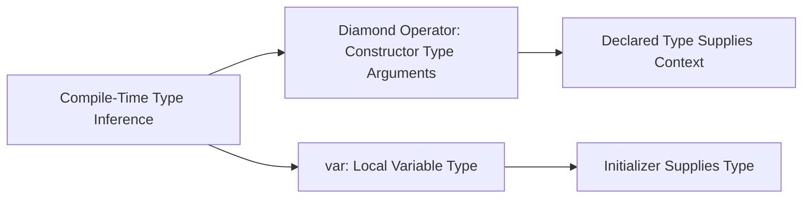
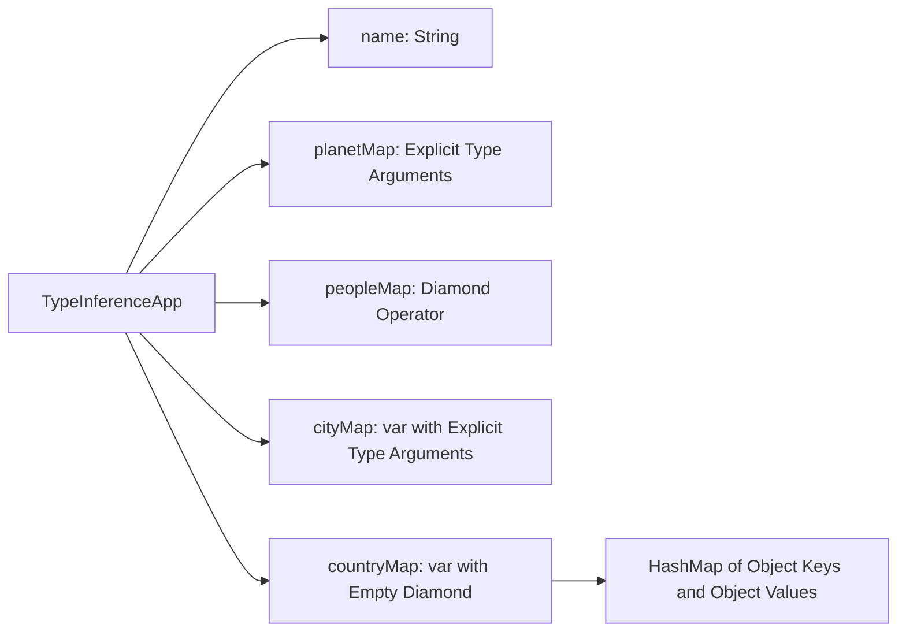

# Type Inference

Compares explicit generic type arguments, the diamond operator, and local variable type inference with `var`.

## Responsibilities

1. **Application Entry Point (`TypeInferenceApp`):** creates a local string and populates maps using different declaration styles.
2. **Explicit Generic Example (`planetMap`):** repeats `Integer` and `String` type arguments in the declaration and constructor.
3. **Diamond Operator Example (`peopleMap`):** infers constructor type arguments from `HashMap<String, Integer>` on the left.
4. **Local Variable Examples (`name`, `cityMap`, `countryMap`):** infer variable types from their initializers and show how omitted type arguments affect a map.

## Learning Notes

- Before Java 7, parameterized constructors required explicit type arguments.
- Java 7 introduced the diamond operator (`<>`).
- Java 10 introduced `var` for local variable type inference: In these declarations, an initializer supplies the type.
- `var` cannot declare fields, method parameters, or return types.
- `var name = "Guilherme"` infers `String`: The variable remains statically typed, so it cannot later hold an integer.
- `HashMap<String, Integer> peopleMap = new HashMap<>()` uses the declared variable type to infer the constructor's key and value types.
- `var cityMap = new HashMap<String, String>()` infers `HashMap<String, String>` from the explicit constructor type arguments.
- `var countryMap = new HashMap<>()` infers `HashMap<Object, Object>`: It is a parameterized map, and it accepts both the string-to-integer and integer-to-string entries in the example.

## Concept Flow

## Implementation Flow

