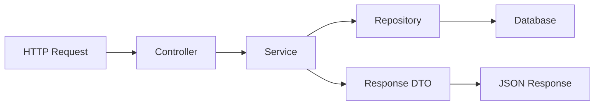
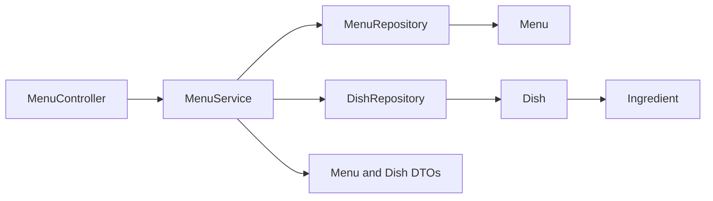

# Menu REST API

Exposes menu, available-dish, and ingredient queries through Spring MVC, JPA repositories, and response DTOs.

## Responsibilities

1. **Application Entry Point (`WebCrudApp`):** starts the Spring Boot application.
2. **HTTP Controller (`MenuController`):** exposes the GET routes and delegates to the service.
3. **Application Service (`MenuService`):** loads data, applies availability filtering through repository methods, and constructs responses.
4. **Repositories (`MenuRepository`, `DishRepository`):** query menus and dishes, including dish ownership and availability conditions.
5. **Entities (`Menu`, `Dish`, `Ingredient`):** map database tables and relationships.
6. **Response DTOs (`MenuDto`, `MenuDishesDto`, `DishDto`, `DishIngredientsDto`, `IngredientDto`):** select the fields returned by each endpoint.
7. **CORS Configuration (`CorsConfiguration`):** allows GET requests from the two configured local frontend origins.

## Learning Notes

- The package is named `crud`, but the current controller implements GET operations only.
- Controller mappings are relative to `/v1/menus`; the shared `spring.mvc.servlet.path=/api` adds the `/api` prefix.
- `GET /api/v1/menus` lists menus; `GET /api/v1/menus/{id}/dishes` returns a menu and its available dishes.
- `GET /api/v1/menus/{menuId}/dishes/{dishId}` returns ingredients only for an available dish belonging to that menu.
- DTO constructors map entities to response records; streams and constructor references build nested DTO lists.
- Missing menus or matching dishes raise `IllegalArgumentException`. This package has no dedicated handler translating those exceptions to HTTP 404.
- `mappedBy` points to the Java relationship field on the owning entity. Foreign keys are declared by `Dish.menu` and `Ingredient.dish`.
- CORS allows GET from `http://localhost:3000` and `http://localhost:4000`; these are specific origins, not a wildcard.

## Concept Flow

## Implementation Flow

