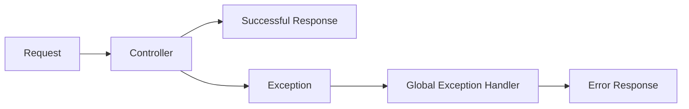
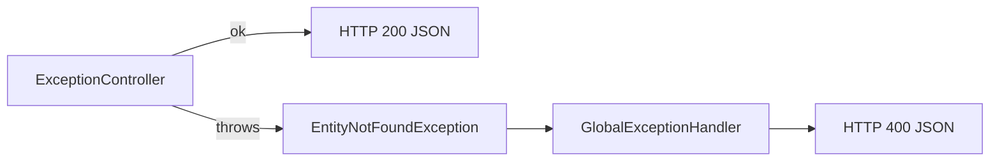

# Global Web Exception Handling

Demonstrates a successful JSON response and centralized handling of a controller exception.

## Responsibilities

1. **Application Entry Point (`WebExceptionApp`):** starts the Spring Boot application.
2. **HTTP Controller (`ExceptionController`):** returns an OK response or throws `EntityNotFoundException`.
3. **Global Handler (`GlobalExceptionHandler`):** catches exceptions covered by `@ExceptionHandler(Exception.class)` and returns a JSON error response.
4. **Response Builder (`JSONObject`, `ResponseEntity`):** creates JSON text and controls the response status and content type.

## Learning Notes

- `@RestControllerAdvice` centralizes exception handling for the controllers in this application context.
- The shared servlet prefix is `/api`; the controller maps `/v1/exception`.
- `GET /api/v1/exception/ok` returns HTTP 200 with a JSON message.
- `GET /api/v1/exception/entityNotFound` throws an exception; the local JSON object created before the throw is never returned.
- The current handler always uses `badRequest()`, so this `EntityNotFoundException` produces HTTP 400, not HTTP 404.
- `JSONObject.toString()` supplies JSON text to `ResponseEntity<String>`; `MediaType.APPLICATION_JSON` declares the response format.

## Concept Flow

## Implementation Flow

